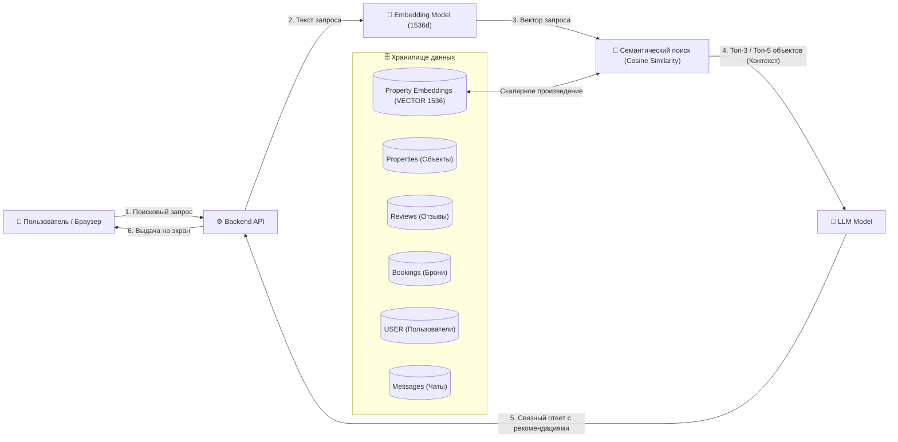

# Sutochno & Booking RAG AI Architecture

Данная ветка (`architecture-diagram`) реализует архитектуру базы данных и конвейер **RAG (Retrieval-Augmented Generation)** в **100% точном соответствии с диаграммой проекта**.

---

## 1. Архитектурная схема системы



---

## 2. Структура базы данных (7 таблиц схемы)

Все таблицы и поля строго соответствуют блокам на диаграмме сущностей (ERD):

| № | Таблица на диаграмме | Назначение и ключевые поля |
|---|---|---|
| 1 | **`USER`** (`users`) | Пользователи системы: `id`, `email`, `password_hash`, `phone`, `first_name`, `last_name`, `role` (`'guest'`, `'host'`, `'admin'`), `created_at`. |
| 2 | **`Properties`** (`properties`) | Объекты аренды: `id`, `host_id`, `title`, `description`, `type` (`'apartment'`, `'house'`, `'room'`), `price_per_night`, `latitude`, `longitude`, `address`, `max_guests`, `is_available`. |
| 3 | **`Property Embeddings`** (`property_embeddings`) | Векторные эмбеддинги жилья: `property_id`, `embedding` (`VECTOR(1536)`), `document_text`. |
| 4 | **`Bookings`** (`bookings`) | Сделки бронирования: `id`, `property_id`, `guest_id`, `check_in_date`, `check_out_date`, `total_price`, `status` (`'pending'`, `'confirmed'`, `'cancelled'`, `'completed'`), `created_at`. |
| 5 | **`Messages chats`** (`chats`) | Чаты по объектам: `id`, `property_id`, `guest_id`, `host_id`, `created_at`. |
| 6 | **`Messages messages`** (`messages`) | Сообщения диалога: `id`, `chat_id`, `sender_id`, `message_text`, `is_read`, `created_at`. |
| 7 | **`Reviews`** (`reviews`) | Отзывы гостей: `id`, `booking_id`, `rating_location`, `rating_cleanliness`, `rating_value`, `comment`, `host_reply`, `created_at`. |

DDL-описания доступны в:
* **PostgreSQL 16 + pgvector:** [`db_schema_postgres.sql`](db_schema_postgres.sql)
* **SQLite:** [`src/db/schema_sqlite.py`](src/db/schema_sqlite.py)

---

## 3. RAG-Конвейер (4 шага из таблицы)

| № | Название этапа | Входные данные | Компонент / Процесс | Выходные данные | Хранение / Результат |
|---|---|---|---|---|---|
| **1** | **Векторизация базы** | Текст: `title + description` (из таблицы `properties`) | **Embedding Model** (преобразование слов в математические координаты 1536d) | Вектор числовых значений (размерность 1536d) | Запись в векторную БД (`property_embeddings`) |
| **2** | **Векторизация запроса** | Текстовый поисковый запрос пользователя (*«квартира у парка»*) | **Embedding Model** (обработка той же моделью, что и на Шаге 1) | Вектор запроса (1536d) | Передача в блок математического сравнения |
| **3** | **Семантический поиск** | Вектор запроса пользователя | Расчет косинусного сходства (**Cosine Similarity**) между запросом и базой | ID и данные наиболее похожих объектов (Топ-3 или Топ-5) | Извлеченный текстовый контекст для нейросети |
| **4** | **Генерация ответа** | Контекст (Топ квартир) + Текст запроса пользователя | **LLM (Языковая модель)** формирует естественный текстовый ответ | Финализированный связный текст с рекомендациями | Выдача ИИ на экран пользователю |

Реализация находится в [`src/ai_engine/search_engine.py`](src/ai_engine/search_engine.py).

---

## 4. Как запустить и продемонстрировать

### 1) Запуск и наполнение базы данных
```powershell
python src/db/seed_data.py
```
*Скрипт автоматически создаёт все 7 таблиц и выполняет **Шаг 1 (векторизацию базы в 1536d)**.*

### 2) Демонстрация 4 шагов RAG в терминале
```powershell
python demo.py
```
*Выполняет Шаги 2, 3 и 4 по тестовым запросам, отображая векторы, косинусное сходство и ответ языковой модели.*

### 3) Интерактивный терминальный чат
```powershell
python chat.py
```

### 4) Запуск веб-сервера и браузерного интерфейса
```powershell
python -m uvicorn src.api:app --reload
```
* Открыть в браузере: **http://127.0.0.1:8000**
* Документация API Swagger: **http://127.0.0.1:8000/docs**
